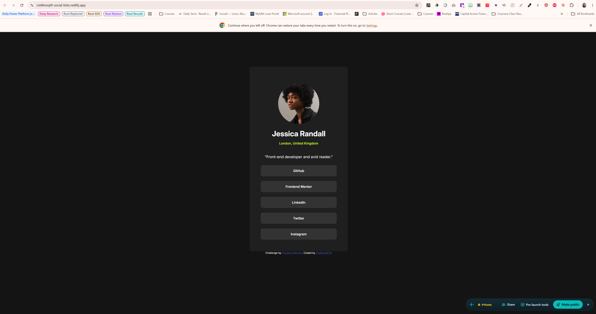

# Frontend Mentor - Social links profile solution

This is a solution to the [Social links profile challenge on Frontend Mentor](https://www.frontendmentor.io/challenges/social-links-profile-UG32l9m6dQ). Frontend Mentor challenges help you improve your coding skills by building realistic projects. 

## Table of contents

- [Overview](#overview)
  - [The challenge](#the-challenge)
  - [Screenshot](#screenshot)
  - [Links](#links)
- [My process](#my-process)
  - [Built with](#built-with)
  - [What I learned](#what-i-learned)
  - [What I'd do differently](#what-id-do-differently)
  - [AI Collaboration](#ai-collaboration)
- [Author](#author)

## Overview

### The challenge

Users should be able to:

- See hover and focus states for all interactive elements on the page

### Screenshot

### Links

- Solution URL: https://github.com/Cre8tiveQT9/social-links-profile
- Live Site URL: https://cre8tiveqt9-social-links.netlify.app/

## My process

### Built with

- Semantic HTML5 markup
- Flexbox
- Inter from Google Fonts
- CSS pseudo-classes
- CSS class and element selectors
- Desktop design

### What I learned

The hardest part of this project was the buttons. I lost the most time getting them to space out, and then again figuring out how the hover state works. I learned that spacing rules like gap go on the parent container, so I needed to give the five buttons their own container div instead of leaving them next to the photo, name, and bio. Styling each button is a separate job from styling the container that holds them.

I also learned that a pseudo-class like :hover is just a state added to a selector I already know, like button:hover.

A few small bugs cost me time too: a missing dot on a class selector, margin: auto overriding my margin-top, and a preview that was showing an old copy of my page. Checking in Chrome helped me catch that last one.

### What I’d do differently

Next time I’ll plan my HTML groupings before writing any CSS. I’ll look at the design, decide which pieces belong together, and give each group its own container div, starting with one for the buttons.

### AI Collaboration

I used Claude as a mentor while building this project. It didn't tell me how to build it or write the code for me. Instead, it gave me guidance when I got stuck and asked me questions that led me to the answers myself, so I wrote the HTML and CSS on my own. For the setup steps I had never done before, like installing Git, pushing to GitHub, and deploying to Netlify, it walked me through each step.

What worked well was the question-based approach. When my buttons wouldn't space out, I had to work out for myself that they needed their own container, and that made the lesson stick.

What didn't work as well was debugging when the preview wasn't updating. It took several rounds of back and forth before I tested with a bright color and checked in Chrome, and that's when I found out the preview was showing an old copy of my page.

## Author

- Website - [J. Lyons Design Studio](https://jlyonsdesignstudio.com)
- Frontend Mentor - [@Cre8tiveQT9](https://www.frontendmentor.io/profile/Cre8tiveQT9)

